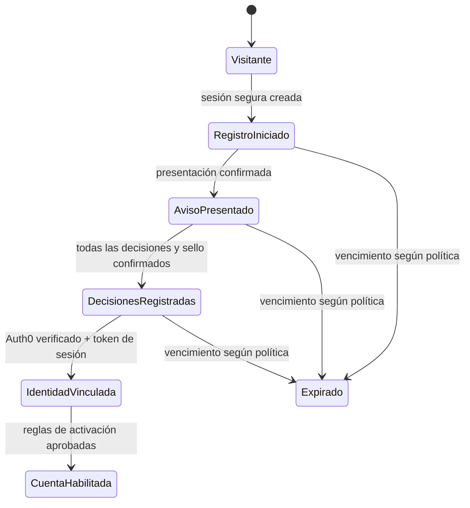

# Contrato compartido propuesto: identidad, registro, privacidad y autorización

**BORRADOR PARA REVISIÓN.** El endpoint experimental `GET /api/v1/privacy/notices/current` está deshabilitado y responde 503; las demás rutas propuestas aquí siguen sin implementarse. Capacidades académicas usan una ruta diferente, `/api/v1/auth/capabilities`. Esta etapa requiere una candidata SQL no aprobada, probada en base desechable; no aprueba política de privacidad, alta, permisos ni producción. Copia idéntica en `LawWare-frontend/docs/api/CONTRATO_FULL_STACK_PROPUESTO.md`; revisar ambas conjuntamente.

## Implementación comprobada

| Operación | Contrato actual y límite |
|---|---|
| Backend `GET /health` | 200 `{ "status": "ok" }`; solo confirma proceso. Frontend servidor `/api/health` lo consulta. |
| Backend `GET /api/v1/auth/me` | Bearer verificado; 200 `{ "id_usuario": "<uuid>", "estado": "ACTIVO" }`; 401 token ausente/no verificable, 403 usuario inexistente o no activo, 503 Auth/almacén no configurado, 500 error interno. No diferencia la causa del 403. |
| Frontend `GET /api/identity` | Sesión SDK y access token en servidor; devuelve la identidad validada. Sin sesión: 401; SDK sin configuración: 503. Preserva 401, 403, 500, 502 y 503 del adaptador con mensajes genéricos y `no-store`. No implementa registro. |

El SDK Express actualmente puede convertir errores de discovery/JWKS a 401 junto con tokens inválidos. No interpretar ese 401 como prueba definitiva de token inválido. Los resultados de seguridad reales en Auth0 y la respuesta autenticada entre repositorios siguen **sin probar**.

## Convenciones propuestas

- Rutas `/api/v1/...` designan backend; el navegador interactuaría mediante el BFF Next y cookie de sesión protegida. `A`: access token Auth0 verificado para audiencia de la API; `R`: secreto de prerregistro de alta entropía en sesión de servidor protegida; `P`: permiso efectivo verificado por backend. Las rutas de navegador y la política de cookies/CSRF quedan por aprobar. Nunca usar identificadores públicos como credencial.
- Para escrituras: validación estricta, `Content-Type: application/json`, control de origen y CSRF en BFF, límites de tamaño y tasa, auditoría sin secretos y transacción en una sola conexión. Rutas autenticadas con `Cache-Control: no-store`. No usar email para vincular identidad ni aceptar actor o permisos del cliente.
- Propuesta de error uniforme `{ "error": "CODIGO", "requestId": "<uuid>" }`; sin secretos ni detalles internos. `400` entrada inválida; `401` autenticación ausente/no verificable; `403` prohibido; `404` recurso no visible; `409` conflicto; `410` prerregistro expirado; `422` reglas incumplidas; `429` límite; `500` interno; `503` dependencia indisponible. Estos códigos son propuesta y no cambian los endpoints actuales. No permitir enumeración pública de cuentas.
- `Idempotency-Key` se propone solo para operaciones de escritura donde se implementen almacenamiento y reconciliación transaccional seguros, limitados a actor/sesión, operación y carga. **La infraestructura actual no proporciona esa garantía.** Repetición de misma clave/carga devuelve resultado confirmado; clave reutilizada con otra carga da 409. Sin esa implementación, una desconexión después del commit produce resultado desconocido que debe consultarse, no repetirse ciegamente.
- En tablas siguientes, `200/201` indica respuesta tras confirmación persistida cuando corresponda; la forma exacta y campos opcionales se concretarán en esquema compartido. En pruebas, cada operación exige también validación de entrada, errores genéricos, no filtración de secretos, CSRF cuando aplique y control de acceso negativo.

## Identidad y sesión: propuestas

| Método y ruta | Autenticación / permiso | Entrada → respuesta | Errores | Reglas de negocio | Pruebas específicas |
|---|---|---|---|---|---|
| `GET /api/v1/identity/session` | A; ninguna capacidad de negocio | Sin entrada → 200 `{ authenticated: true }` | 401, 503 | Solo confirma token verificado, no que exista usuario LawWare; datos mínimos. | Emisor/audiencia/firma/expiración; JWKS caído; no elevar acceso. |
| `GET /api/v1/identity/account` | A; acceso al propio sujeto | Sin identificador de cliente → 200 `{ account: "ABSENT" }` o `{ account: "PRESENT", state }` bajo política aprobada | 401, 403, 503 | Busca `usuario.auth0_id` por `sub`; acceso y exposición de estados requieren política anti-enumeración. No activa, crea ni vincula. Si el sujeto fue anonimizado y no hay asociación no se puede inferir ese estado. | Ausente, pendiente, activo, bloqueado, inactivo y anonimizado solo cuando la asociación exista; identificadores ajenos; concurrencia. |
| `POST /api/session/login` y `POST /api/session/logout` en BFF | Sesión/CSRF según SDK | Inicio o cierre → redirección controlada | 400, 401, 503 | Adaptadores propuestos; las rutas actuales del SDK son distintas y su interacción debe acordarse. Sesión válida no equivale a autorización interna. Definir recuperación explícita; nunca iniciar registro por 401/403. | Ciclo real Auth0, expiración/renovación, retorno seguro, CSRF y cookies. |

## Prerregistro, presentación y decisiones: propuestas

| Método y ruta | Autenticación / permiso | Entrada → respuesta | Errores | Reglas de negocio | Pruebas específicas |
|---|---|---|---|---|---|
| `POST /api/v1/registration/sessions` | Visitante, R creada por servidor | Sin identidad ni rol elegido → 201 `{ registrationId, status }` y secreto solo en canal de sesión seguro | 400, 429, 503 | Secreto aleatorio, solo hash en persistencia aplicable; `registrationId` público no autoriza. Definir almacén temporal, expiración, cookies `HttpOnly`/`Secure`/`SameSite`, CSRF e idempotencia. SQL no tiene tabla de sesión independiente. | Entropía, no enumeración, expiración, fijación de sesión, doble solicitud y secretos fuera de logs. |
| `GET /api/v1/registration/sessions/current` | R | Sin ID de cliente → 200 `{ status, expiresAt }` | 401, 404, 410, 503 | Solo sesión propietaria; no revelar secreto ni evidencia de terceros. | Sesión distinta, alterada, expirada y reanudación. |
| `GET /api/v1/privacy/notices/current` | Propuesta: visitante o R; implementación actual requiere cuenta activa y está deshabilitada | Propuesta: tipo → `{ noticeId, type, version, content, effectiveAt, purposes[] }`; actualmente responde 503 `PRIVACY_NOT_AVAILABLE` | 401, 403, 503 | No consulta avisos ni registra presentación o consentimiento. Acceso y esquema final pendientes de aprobación. | Sin aviso, versión retirada, hash y cambios concurrentes. |
| `POST /api/v1/registration/presentations` | R | `{ noticeId }` → 201 `{ presentationId, version, presentedAt }` | 400, 401, 409, 410, 422, 503 | Servidor selecciona sesión y hash; registrar puesta a disposición, no lectura. `aviso_presentacion` exige `id_sesion_registro` único, hash de token y condiciones de IP/minimización. Confirmar tras commit. | Aviso no vigente, duplicación, sesión ajena/expirada, hash, rollback y carrera de versión. |
| `POST /api/v1/registration/decisions` | R y presentación propia | `{ presentationId, decisions: [{ purposeId, authorized }] }` → 201 `{ decisionId, confirmedAt }` | 400, 401, 409, 410, 422, 503 | Una decisión por presentación; cada finalidad consentible explícita. Insertar evento y finalidades, sellar con `fn_sellar_evento_consentimiento` y confirmar en una transacción. No exponer token ni hash como autorización. Ventana SQL de 24 h es provisional. El sellado exige al menos una finalidad: resolver caso de cero finalidades antes de aprobar. | Todas las opciones, rechazo, faltantes/duplicadas, cero finalidades, sello, rollback, reintento y carreras. |
| `POST /api/v1/registration/link` | A + R; cuenta propia permitida | `{ presentationId }` → 200 `{ linked: true, accountState }` | 401, 403, 409, 410, 422, 503 | `sub` y UUID resueltos por servidor; `fn_vincular_prerregistro` exige coincidencia de contexto, token auténtico, cuenta pendiente/activa y plazo SQL. No vincular por correo ni usar UUID del body. Resolver creación previa de usuario y casos sin decisión. | Token ajeno, expirado, sujeto errado, repetición, concurrencia, presentación sin consentimiento y rollback. |
| `POST /api/v1/registration/activation` | A + R vinculada; reglas pendientes | Sin rol ni estado suministrados → 200 `{ state: "ACTIVO" }` | 401, 403, 409, 410, 422, 503 | Propuesta bloqueada hasta aprobar precondiciones de privacidad, identidad, auditoría y permisos; el SQL no define por sí solo un flujo completo de activación. No activar automáticamente al verificar JWT. | Sin vinculación, sin decisiones requeridas, duplicado, rol forjado, falla de auditoría y carrera. |

## Privacidad de cuenta y autorización: propuestas

| Método y ruta | Autenticación / permiso | Entrada → respuesta | Errores | Reglas de negocio | Pruebas específicas |
|---|---|---|---|---|---|
| `GET /api/v1/privacy/evidence` | A + cuenta propia activa; P si se define | Paginación acotada → 200 `{ items, nextCursor }` | 400, 401, 403, 503 | Solo evidencia propia y sellada; minimizar datos. RLS y credencial adecuada no sustituyen autorización. | Titular ajeno, paginación, evidencia no sellada, logs sin datos sensibles. |
| `POST /api/v1/privacy/revocations` | A + titular activo; P si se define | `{ decisionId, purposeIds[] }` → 201 `{ revocationId, confirmedAt }` | 400, 401, 403, 404, 409, 422, 503 | Solo finalidades autorizadas de decisión original sellada y propio titular; evento `REVOCACION`, mismo aviso/presentación, sello y commit. No revocar dos veces la misma finalidad de la misma decisión. | Ajenas, no autorizadas, duplicadas, revocaciones concurrentes, sello y rollback. |
| `GET /api/v1/authorization/effective` | A + usuario activo | Sin rol de cliente → 200 `{ roles: [], permissions: [], capabilities: [] }` | 401, 403, 503 | Unión de roles y permisos activos y vigentes; capacidades derivadas en servidor bajo política aprobada. Códigos aún no definidos. Frontend filtra navegación, backend verifica cada operación. | Roles múltiples, expiración/revocación, permisos inactivos, cambios entre consulta y operación, acceso denegado. |
| `POST /api/v1/admin/users/{userId}/roles` | A + P administrativa específica | `{ roleId }` → 201 `{ assignmentId }` | 400, 401, 403, 404, 409, 422, 503 | Actor derivado del token; rol existente permitido y asignación autorizada con auditoría; nunca desde registro público. Alcance de rol técnico y política aún por aprobar. | Escalada, rol inexistente, asignación duplicada, actor bloqueado, auditoría y carrera. |
| `DELETE /api/v1/admin/users/{userId}/roles/{assignmentId}` | A + P administrativa específica | IDs de recurso → 200 `{ revoked: true }` | 400, 401, 403, 404, 409, 503 | Revocación controlada conforme `usuario_rol.estado/fecha_fin`, no borrado histórico arbitrario; auditar y verificar titularidad de asignación. | Denegación, asignación ajena, repetición, última capacidad administrativa y rollback. |

## Máquina de estados propuesta

Las etapas de prerregistro son estados de flujo **propuestos**, no valores de `usuario.estado`. La operación que produce cada transición aún no existe.

Este diagrama no obliga a que todas las cuentas pasen por la misma ruta ni permite saltos automáticos. Revisión necesaria para usuarios ya existentes, presentación sin finalidades consentibles, reversión/reanudación, protección ante repetición, momento de alta del usuario y orden entre identidad y decisiones. El límite SQL de 24 horas es técnico y provisional, no plazo legal.

## Estados de cuenta y capacidades

| Estado en `lawware.usuario` | Tratamiento de propuesta | Capacidades reales |
|---|---|---|
| `PENDIENTE_REGISTRO` | Solo pasos permitidos por un contrato seguro de prerregistro; `/auth/me` actual responde 403. | Ninguna concedida automáticamente. |
| `ACTIVO` | `/auth/me` puede resolver identidad; acceso a cada recurso sujeto a permisos. | Unión de permisos efectivos validada en backend. |
| `BLOQUEADO` | Denegar operaciones; recuperación y soporte sujetos a política. | Ninguna concedida por interfaz. |
| `INACTIVO` | Denegar operaciones; reactivación requiere política y autoridad. | Ninguna concedida por interfaz. |
| `ANONIMIZADO` | Denegar operaciones; asociación Auth0 podría no existir, por lo que no inferir identidad. | Ninguna concedida por interfaz. |
| Sin cuenta asociada | Respuesta segura solo tras identidad validada y política anti-enumeración. | Ninguna; no crear o vincular automáticamente. |

## Puntos que impiden aprobación

Textos y finalidades legales; orden de prerregistro e identidad; titularidad y almacén de la sesión; creación/activación del usuario; expiración de 24 horas; política de cero finalidades; idempotencia y recuperación ante resultado desconocido; contratos de roles y granularidad de permisos; retención/minimización de IP y evidencia; alcance de auditoría externa; credenciales técnicas, RLS, pool y TLS administrados; pruebas con Auth0 real, cookies, CSRF y rotación de claves. El SQL otorga al servicio Auth SELECT/INSERT/UPDATE sobre `usuario`; el código actual solo realiza SELECT, y revisar mínimos privilegios antes de producción no es equivalente a modificar el esquema silenciosamente.
